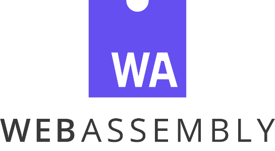

## Agenda for the May 5 video call of WebAssembly's SIMD Subgroup

- **Dates**: 2026-05-08
- **Times**:
    - 4pm-5pm UTC (9am-10am PDT)
- **Location**: *link on calendar invite*
- **Contact**:
    - Name: Petr Penzin
    - Email: penzin.dev@gmail.com

### Registration

Fill out [sign-up form](https://forms.gle/bscWhsD9U4hZEsUV9) to attend.

### Logistics

This meeting will be a Google Meet video conference.

## Agenda items

1. MDN published a version on Wasm SIMD docs
1. Arm support
1. Predicate support for vector operations
1. SIMD/vector workloads

## Meeting notes

Attendees:

- Anton Kirilov
- Petr Penzin
- Yury Delendik

Notes:

1. MDN published a version on Wasm SIMD docs
   1. https://developer.mozilla.org/en-US/docs/WebAssembly/Reference/SIMD
   1. https://github.com/mdn/mdn/issues/821
1. Arm support
   1. Work underway to add more SVE support to V8, as well as recognize patterns that fit Neon instructions better
1. Predicate support for vector operations
   1. We can add a portable set of types and operations, treating predicate as opaque
   1. Prior discussion: https://github.com/WebAssembly/flexible-vectors/issues/13
1. SIMD/vector workloads
   1. Arm published a set of [wasm workloads](https://gitlab.arm.com/runtimes/wasm-perf)

